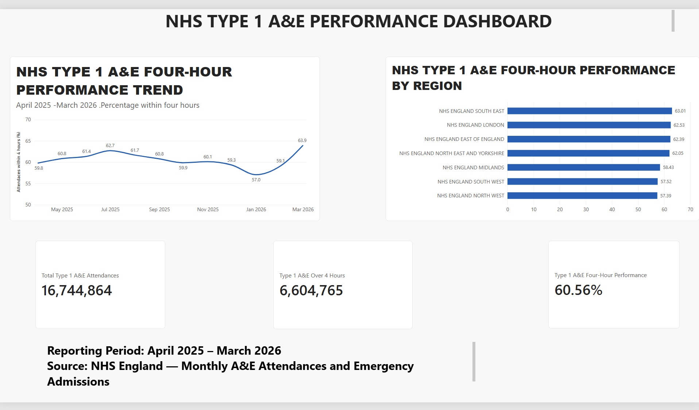

# NHS-AE-PERFORMANCE-ANALYSIS
Analysis of NHS England Type 1 A&amp;E performance using SQL and Power BI, April 2025–March 2026.

## Project Overview

This project analyses NHS England Type 1 Accident & Emergency (A&E) performance from April 2025 to March 2026 using SQL and Power BI.

The analysis examines patient attendance volumes, the proportion of attendances completed within four hours, monthly performance trends, and regional differences.

The objective is to transform publicly available NHS operational data into clear, actionable insights that help identify performance patterns and potential areas for further investigation.

### Key Questions
- How many Type 1 A&E attendances were recorded during the reporting period?
- What proportion exceeded four hours?
- How did four-hour performance change month by month?
- Which NHS regions recorded the highest and lowest four-hour performance?

## Key Findings

- **Total A&E Attendances:** 16,744,864 Type 1 A&E attendances were recorded between April 2025 and March 2026.
- **Attendances Exceeding Four Hours:** 6,604,765 attendances (39.44%) exceeded four hours.
- **Annual Four-Hour Performance:** 60.56% of attendances were completed within four hours.
- **Highest Regional Performance:** South East recorded 63.01% four-hour performance.
- **Lowest Regional Performance:** North West recorded 57.39% four-hour performance.
- **Regional Performance Gap:** The difference between the highest- and lowest-performing regions was 5.62 percentage points.

### Interpretation

The results indicate that a substantial proportion of Type 1 A&E attendances exceeded four hours during the reporting period. Regional performance also varied, suggesting areas for further investigation into operational pressures, patient demand and service capacity. These descriptive findings do not establish the causes of the observed differences.

## Power BI Dashboard

